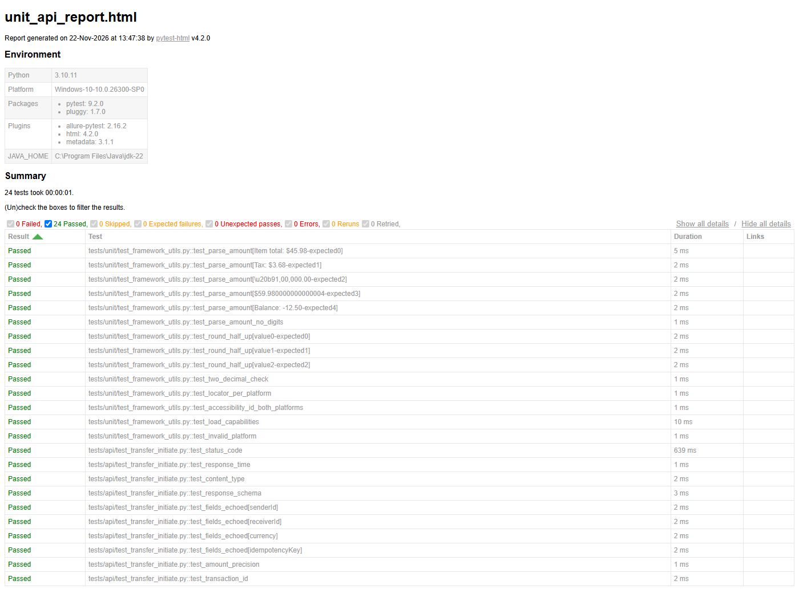

# PaySwift QA Automation Assignment

Test strategy, mobile UI automation and API checks for the PaySwift Instant Money Transfer module.

| Part | Where |
|------|-------|
| Part 1: Test strategy, scenarios, BVA, detailed test cases, Jira defect | [`TEST_STRATEGY_AND_CASES.md`](TEST_STRATEGY_AND_CASES.md) |
| Part 2: Appium + pytest framework (POM, Android and iOS) | `framework/`, `locators/`, `pages/`, `tests/ui/` |
| Part 3: API checks | `tests/api/` (pytest + requests) and [`postman/PaySwift_Transfer_API.postman_collection.json`](postman/PaySwift_Transfer_API.postman_collection.json) |
| Negative API matrix and status-code to UI-state mapping | [`docs/NEGATIVE_API_TEST_MATRIX.md`](docs/NEGATIVE_API_TEST_MATRIX.md) |

## App under test

The PaySwift build isn't available, so the UI suite runs against the open-source **Sauce Labs "Swag Labs" sample app v2.7.1** ([saucelabs/sample-app-mobile](https://github.com/saucelabs/sample-app-mobile)). It is a React Native app with the same accessibility ids on Android and iOS, which makes it a good stand-in for a cross-platform banking app.

| PaySwift flow | Demo app equivalent | Test |
|---------------|---------------------|------|
| PIN login, then transfer, then receipt with amount check | Login, cart, checkout overview totals, order confirmation | `test_01_checkout_happy_path.py` |
| Account lockout and input validation | `locked_out_user`, wrong password, empty fields, required checkout fields | `test_02_validation_errors.py` |
| Find a transaction in history | Swipe the product list to an item that starts off-screen, open it, verify name, description and price | `test_03_list_scroll_gesture.py` |

The locators and expected messages were taken from the app's own JavaScript bundle (the `test-` prefix helper and the English strings file), not guessed.

## Project layout

```
├── config/capabilities.yaml     # Android + iOS capabilities, ${ENV:-default} overrides
├── framework/
│   ├── config.py                # settings from env vars, capability loading
│   ├── driver_factory.py        # one entry point: UiAutomator2 or XCUITest
│   ├── locator.py               # Locator(android=..., ios=...) resolved at runtime
│   ├── waits.py                 # explicit waits only (implicit wait set to 0)
│   ├── gestures.py              # W3C pointer swipes + scroll-until-visible
│   ├── money.py                 # Decimal parsing/rounding for amount assertions
│   └── data_loader.py           # JSON test data loaded with Decimal for numbers
├── locators/                    # screen locators only, no logic
├── pages/                       # page objects: actions and state, no assertions
├── test_data/                   # users, products, checkout and API payloads
├── tests/
│   ├── ui/                      # the 3 required Appium tests (8 cases after parametrisation)
│   ├── api/                     # transfer initiation contract tests + JSON schema
│   └── unit/                    # framework utility tests (no device needed)
├── postman/                     # exported Postman collection (v2.1)
├── scripts/download_apps.sh     # fetches the demo APK / simulator .app
├── conftest.py                  # --platform option, screenshot + page source on failure
└── reports/                     # generated reports and failure screenshots
```

### Design decisions

- **Strict layering.** Locators live in `locators/`, page objects in `pages/` expose actions and return values, tests in `tests/` hold every assertion, and data lives in `test_data/`. Page objects never assert.
- **One codebase for both platforms.** Each `Locator` holds an Android and an iOS strategy. Where the app exposes the same accessibility id on both, `Locator.accessibility_id()` is used. Where it doesn't (error text nodes, summary labels without ids), Android uses UiAutomator/XPath and iOS uses predicate strings or class chains. Page objects don't know which platform they're on.
- **No static waits.** There is no `time.sleep()` anywhere. Implicit wait is set to 0 so it can't stack with explicit waits. Every wait in `framework/waits.py` polls for a condition and reports which locator it was waiting for.
- **Scrolling that knows when to stop.** `scroll_until_visible` compares visible list titles before each swipe and fails as soon as a swipe no longer changes the list, instead of swiping a fixed number of times.
- **Money is Decimal.** Prices, totals and API amounts are parsed into `Decimal` and compared exactly. A display value such as `59.980000000000004` fails the check instead of slipping through a float comparison.
- **Failure artefacts.** A hook in `conftest.py` saves a screenshot and the page source for any UI test that fails during setup or execution, and attaches them to the pytest-html report and to Allure.
- **Fresh session per test.** Each UI test gets its own driver, so a failure can't leave state behind for the next test.

## Prerequisites

| Tool | Version used / tested |
|------|------------------------|
| Python | 3.10 or newer |
| Node.js | 20 LTS (for Appium and Newman) |
| Appium server | 2.x (`npm i -g appium`) |
| Appium drivers | `uiautomator2` (Android), `xcuitest` (iOS) |
| Android | Android Studio, SDK Platform-Tools, an emulator on API 34 (Android 14) |
| iOS (macOS only) | Xcode 15+, an iPhone 15 simulator on iOS 17 |
| Java | JDK 17 (needed by the Android SDK tools) |
| Allure CLI (optional) | 2.x, for the Allure HTML report |
| Newman (optional) | `npm i -g newman` to run the Postman collection from the CLI |

### One-time setup

```bash
# 1. Python dependencies
python -m venv .venv
source .venv/bin/activate            # Windows: .venv\Scripts\activate
pip install -r requirements.txt

# 2. Appium server and drivers
npm install -g appium
appium driver install uiautomator2
appium driver install xcuitest       # macOS only

# 3. Demo app builds into ./apps
./scripts/download_apps.sh

# 4. Android: environment and emulator
export ANDROID_HOME="$HOME/Library/Android/sdk"   # or ~/Android/Sdk on Linux
export PATH="$ANDROID_HOME/platform-tools:$ANDROID_HOME/emulator:$PATH"
sdkmanager "system-images;android-34;google_apis;x86_64"     # arm64-v8a on Apple Silicon
avdmanager create avd -n Pixel_7_API_34 -k "system-images;android-34;google_apis;x86_64" -d pixel_7
emulator -avd Pixel_7_API_34 &
adb devices                           # should list emulator-5554

# 5. iOS (macOS): boot a simulator
xcrun simctl boot "iPhone 15"
```

Optional check: `npx appium-doctor --android` (or `--ios`).

Note for Apple Silicon Macs: the 2020 iOS simulator build of the demo app may need the simulator to run under Rosetta if installation fails.

## Running the tests

Start Appium in a separate terminal:

```bash
appium --port 4723
```

UI tests:

```bash
# Android (default platform)
pytest tests/ui --platform android --html=reports/ui-android.html --self-contained-html

# iOS
pytest tests/ui --platform ios --html=reports/ui-ios.html --self-contained-html

# Only the smoke test, or only negative cases
pytest -m smoke --platform android
pytest -m negative --platform android

# Allure report
pytest tests/ui --platform android --alluredir=allure-results
allure serve allure-results
```

API tests:

```bash
pytest tests/api --html=reports/api.html --self-contained-html
```

Postman collection via Newman:

```bash
newman run postman/PaySwift_Transfer_API.postman_collection.json

# HTML report (needs: npm i -g newman-reporter-htmlextra)
newman run postman/PaySwift_Transfer_API.postman_collection.json -r cli,htmlextra --reporter-htmlextra-export reports/newman.html
```

Framework unit tests (no device or network):

```bash
pytest tests/unit
```

Everything at once:

```bash
pytest --platform android --html=reports/full.html --self-contained-html
```

### Configuration overrides

| Variable | Default | Purpose |
|----------|---------|---------|
| `PLATFORM` | `android` | Used when `--platform` isn't passed |
| `APPIUM_SERVER_URL` | `http://127.0.0.1:4723` | Appium server, local or a device cloud |
| `EXPLICIT_WAIT_SECONDS` | `15` | Default explicit wait timeout |
| `MAX_SCROLL_ATTEMPTS` | `8` | Upper bound on swipes per search |
| `ANDROID_DEVICE_NAME` / `ANDROID_PLATFORM_VERSION` / `ANDROID_APP_PATH` | `emulator-5554` / `14` / `apps/...apk` | Android target |
| `IOS_DEVICE_NAME` / `IOS_PLATFORM_VERSION` / `IOS_APP_PATH` | `iPhone 15` / `17.5` / `apps/...app` | iOS target |
| `API_BASE_URL` | `https://jsonplaceholder.typicode.com` | API under test |

## API checks (Part 3)

`tests/api/test_transfer_initiate.py` and the Postman collection both post the assignment payload to `POST https://jsonplaceholder.typicode.com/posts` and check:

- status is `201 Created`
- response time is below 1000 ms
- `Content-Type` is `application/json` (charset suffix ignored)
- body matches `tests/api/schemas/transfer_initiate_response.schema.json`
- `senderId`, `receiverId`, `currency`, `idempotencyKey` echoed unchanged
- `amount` echoed exactly (compared as Decimal) with no more than 2 decimals
- a positive integer `id` is generated (the stand-in transaction id)

The mock accepts any payload, so the negative cases (duplicate `idempotencyKey`, insufficient balance `422`, expired JWT `401`, limits, rate limiting, downstream timeouts and more) are documented with expected status codes **and the UI state each one must produce** in [`docs/NEGATIVE_API_TEST_MATRIX.md`](docs/NEGATIVE_API_TEST_MATRIX.md). A summary is also in the Postman collection description.

## Sample execution report

After a run, the HTML reports are in `reports/`. Failure screenshots and page source dumps go to `reports/screenshots/`.

<!-- Screenshot of the HTML report from an emulator run -->


## Known limitations

- The demo app replaces PaySwift, so PaySwift-specific behaviour (OTP, idempotency, network-drop Pending state, daily limits) is covered in the test strategy and the API matrix rather than in UI automation.
- `jsonplaceholder` is a shared public mock. Latency above 1000 ms on a slow network is a real result of that run, not a framework fault.
